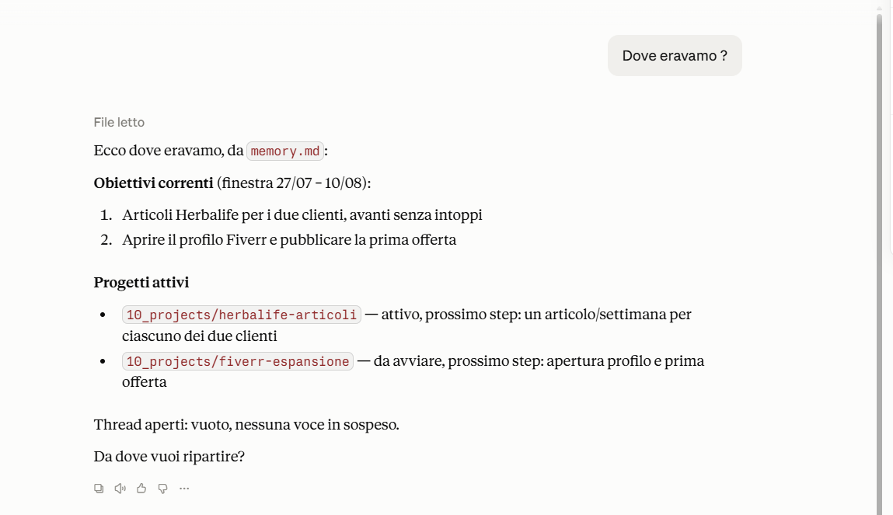

# Virgilio

Un secondo cervello per chi lavora con un assistente AI tutti i giorni.

Non è un sistema di note per te: è il file system che **il tuo assistente legge da solo**, prima di rispondere, in ogni sessione nuova.

---

## Il problema

Apri una chat. L'assistente non sa chi sei, su cosa stai lavorando, cosa avevate deciso ieri. Gli rispieghi tutto. Domani ricominci.

Più progetti hai in parallelo, più questo costa: tempo, token, e decisioni che si perdono perché sono rimaste dentro una conversazione chiusa.

## La prova

Installi il sistema, apri una conversazione e scrivi "ciao". Ti fa tre domande, compila lo stato, e sei operativo.

Poi chiudi la chat. Ne apri una nuova, giorni dopo:



Non gli hai raccontato niente. L'ha letto.

---

## Cos'è, concretamente

Una cartella di file markdown. Nessun database, nessun account, nessun abbonamento, niente che giri in cloud. Si apre con qualsiasi editor, e con Obsidian si vedono anche i collegamenti in grafo.

Dentro ci sono tre cose:

**Le regole** (`CLAUDE.md`) — cosa l'assistente deve fare e dove deve cercare. È il file che viene letto per primo, automaticamente.

**Lo stato** (`memory.md`) — chi sei, cosa stai facendo, cosa è in sospeso. Cambia in continuazione.

**Le procedure** (`03_skills/`) — sette compiti ripetibili che l'assistente sa eseguire: aprire un progetto, digerire appunti grezzi in note collegate, controllare che il sistema non si sia rotto, distillare una competenza in un file da richiamare.

La regola che tiene insieme tutto: **le regole non contengono mai stato.** Un file che dice "il progetto attivo è X" invecchia in due giorni. Le regole puntano allo stato, non lo copiano.

---

## Come si parte

1. Scarica la cartella e mettila dove vuoi sul tuo computer.
2. Collegala al tuo assistente (in Claude: selezionala come cartella di lavoro).
3. Apri una conversazione e scrivi qualsiasi cosa.

Il sistema si accorge da solo di essere vuoto e ti fa tre domande. Da lì è operativo.

Le procedure in `03_skills/` funzionano meglio se le carichi come skill (Impostazioni → Skills, un file alla volta): così si attivano da sole quando servono. L'assistente te lo propone durante il primo avvio.

---

## Cosa c'è dentro

```
CLAUDE.md            regole + mappa di navigazione
memory.md            stato attuale
archive.md           decisioni superate
00_context/          identità, competenze distillate, registro dei feedback
01_raw/              appunti grezzi in attesa di essere digeriti
02_wiki/             conoscenza consolidata, in note atomiche collegate
03_skills/           le sette procedure
10_projects/         una cartella per progetto
99_system/           il manuale delle regole e i template
```

---

## Cosa non fa

Non si sincronizza da solo tra dispositivi: è una cartella, usa lo strumento di sincronizzazione che preferisci.

Non importa automaticamente le note che hai già altrove. Le metti in `01_raw/` e le fai digerire quando vuoi.

Non è pensato per più persone sullo stesso sistema: è personale.

È nato e testato su Claude. Essendo file di testo con istruzioni in linguaggio naturale, funziona in linea di principio con qualsiasi assistente che sappia leggere e scrivere file — ma verificato lo è solo su Claude.

---

## Domande

**In cosa è diverso da un template di note?**
Quelli li leggi tu. Questo lo legge l'assistente, da solo, ogni volta.

**Devo saper programmare?**
No. Si legge e si scrive markdown.

**Dove finiscono i miei dati?**
Sul tuo computer. Il sistema non manda niente da nessuna parte.

**Consuma più token?**
Meno. La mappa in `CLAUDE.md` evita che l'assistente legga tutto per trovare una cosa.

**Cosa succede se non seguo le regole?**
Niente si rompe. Perdi ordine, non dati: sono file tuoi.

---

## Licenza

MIT.
