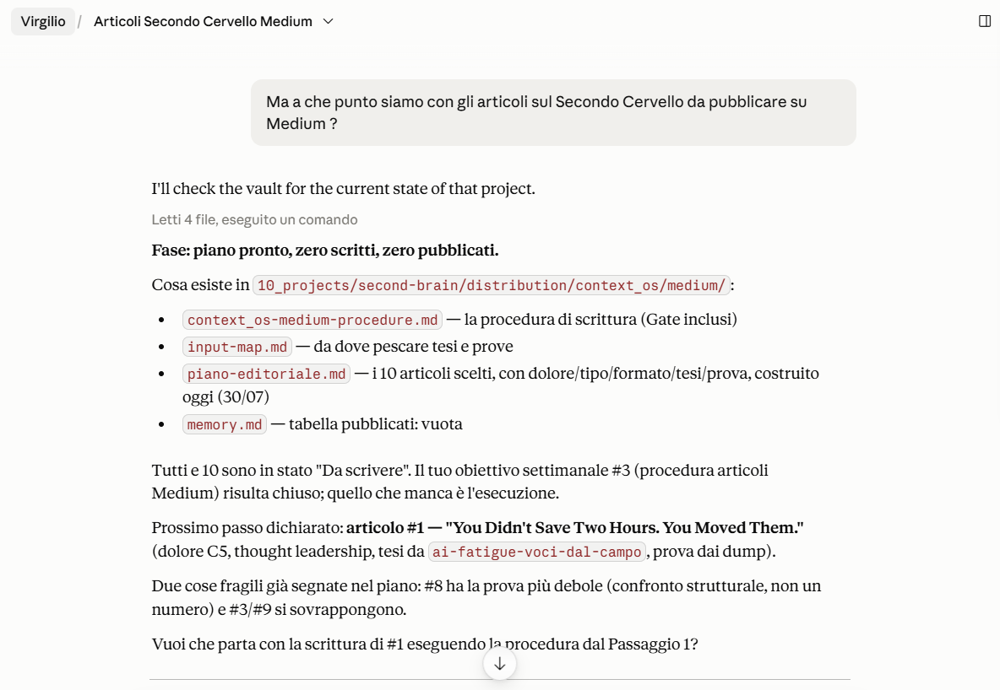
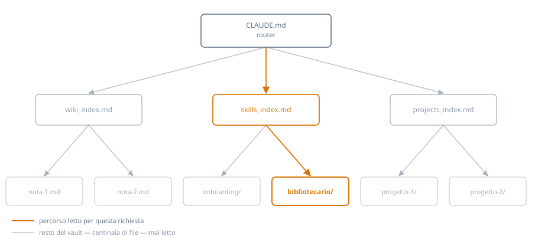

<p align="center">
  
</p>

<h1 align="center">Virgilio</h1>

<p align="center">
  <strong>La memoria che l'AI si legge da sola.</strong><br>
  Non un'altra app di note che leggi tu: la cartella che il tuo assistente legge da solo, prima di rispondere, in ogni sessione nuova.
</p>

<p align="center">
  <a href="LICENSE"></a>
</p>

<p align="center">
  <a href="#la-prova">La prova</a> ·
  <a href="#come-funziona">Come funziona</a> ·
  <a href="#come-si-parte">Come si parte</a> ·
  <a href="#le-procedure">Le procedure</a> ·
  <a href="#domande">Domande</a>
</p>

Apri una chat. L'AI non sa chi sei, su cosa stai lavorando, cosa avevate deciso ieri. Glielo rispieghi tutto. Domani ricomincia.

Più progetti hai in parallelo, più questo costa: tempo, token, e decisioni che si perdono perché sono rimaste dentro una conversazione chiusa.

---

## La prova

Installi il sistema, apri una conversazione e scrivi "ciao". Ti fa 3+1 domande, compila lo stato, e sei operativo.

Poi chiudi la chat. Ne apri una nuova, giorni dopo:



Non gli hai raccontato niente. L'ha letto.

Se preferisci vederlo invece di leggerlo: [guarda la demo](assets/VirgilioAI-v1.0.mp4).

Chiedo lo stato, lo cambio, apro un'altra chat: è già aggiornata. Non gliel'ho detto io.

---

## Come funziona

Il difficile in una base di conoscenza non è leggere o pensare — è il bookkeeping: tenere gli indici aggiornati, sapere dove sta cosa, non rileggere tutto ogni volta. Virgilio lo risolve con un router: `CLAUDE.md` non contiene mai stato, solo la mappa per raggiungerlo. Una richiesta passa dal router a *un* indice a *un* file — il resto della cartella, anche a centinaia di file, resta chiuso.

<p align="center">
  
</p>

<p align="center">
  <sub>Router → indice → file: un solo percorso letto per richiesta</sub>
</p>

Dentro ci sono tre cose:

**Le regole** (`CLAUDE.md`) — cosa l'assistente deve fare e dove deve cercare. È il file che viene letto per primo, automaticamente.

**Lo stato** (`memory.md`) — chi sei, cosa stai facendo, cosa è in sospeso. Cambia in continuazione.

**Le procedure** (`03_skills/`) — sette compiti ripetibili che l'assistente sa eseguire: aprire un progetto, digerire appunti grezzi in note collegate, controllare che il sistema non si sia rotto, distillare una competenza in un file da richiamare.

La regola che tiene insieme tutto: **le regole non contengono mai stato.** Un file che dice "il progetto attivo è X" invecchia in due giorni. Le regole puntano allo stato, non lo copiano.

---

## Cos'è, concretamente

Una cartella di file markdown. Nessun database, nessun account, nessun abbonamento, niente che giri in cloud. Si apre con qualsiasi editor, e con Obsidian si vedono anche i collegamenti in grafo.

---

## Come si parte

1. Scarica la cartella e mettila dove vuoi sul tuo computer.
2. Collegala al tuo assistente (in Claude: selezionala come cartella di lavoro).
3. Apri una conversazione e scrivi qualsiasi cosa.

Il sistema si accorge da solo di essere vuoto e ti fa 3+1 domande. Da lì è operativo.

Le procedure in `03_skills/` sono già skill pronte all'uso: su Claude Code si attivano da sole appena la cartella è quella aperta, senza nessun passaggio in più. Su altri assistenti si installano copiando il contenuto di ogni `SKILL.md` in una nuova skill dalle impostazioni — l'assistente te lo propone durante il primo avvio.

---

## Cosa c'è dentro

```
CLAUDE.md            regole + mappa di navigazione
memory.md            stato attuale
archive.md           decisioni superate
00_context/          identità, competenze distillate, registro dei feedback
01_raw/              appunti grezzi in attesa di essere digeriti
02_wiki/             conoscenza consolidata, in note atomiche collegate
03_skills/           le sette procedure
10_projects/         una cartella per progetto
99_system/           il manuale delle regole e i template
```

---

## Le procedure

| Procedura | Cosa fa | Beneficio |
|---|---|---|
| Onboarding | Si attiva da sola al primo avvio: 3+1 domande, compila `memory.md`, apre il primo progetto. | Da cartella vuota a sistema operativo in pochi minuti, senza leggere una riga di documentazione. |
| Bibliotecario | Smista il materiale grezzo in `01_raw/`: note atomiche nel wiki per la conoscenza, cartelle e stato in `10_projects/` per i progetti. | Ci butti dentro tutto com'è, senza dividerlo: quello che rileggerai diventa conoscenza, quello su cui lavori diventa progetto. |
| Kick-off Progetto | Apre un progetto nuovo: cartella, regole, stato, voce in indice. | Nessun filone di lavoro nasce orfano o si perde perché non indicizzato. |
| Knowledge Pill | Distilla una competenza ricorrente in un file operativo da richiamare al bisogno. | Una competenza spiegata una volta sola, richiamabile per sempre: non la rispieghi mai più. |
| Pulizia Sistema | Controlla link rotti, file orfani, path stale, naming e date disallineate. | Il sistema resta affidabile nel tempo invece di degradare in silenzio finché non lo scopri per caso. |
| Dump Sessione | Chiude una sessione di lavoro con una voce datata nel registro. | Decisioni e correzioni non spariscono quando chiudi la chat: restano scritte, non affidate alla memoria. |
| Feedback Sistema | Corregge alla fonte una regola quando segnali un problema strutturale. | Il sistema impara dai tuoi correttivi nella stessa interazione, invece di farteli ripetere la settimana dopo. |

L'onboarding parte da sola al primo messaggio. Le altre sei sono cartelle skill (`<nome>/SKILL.md`): su Claude Code si attivano da sole quando il contesto lo richiede, altrove si installano una alla volta dalle impostazioni.

---

## Cosa non fa

Non si sincronizza da solo tra dispositivi: è una cartella, usa lo strumento di sincronizzazione che preferisci.

Non importa automaticamente le note che hai già altrove. Le metti in `01_raw/` e le fai digerire quando vuoi.

Non è pensato per più persone sullo stesso sistema: è personale.

È nato e testato su Claude Cowork. Essendo file di testo con istruzioni in linguaggio naturale, funziona in linea di principio con qualsiasi AI che sappia leggere e scrivere file — ma verificato lo è solo su Claude Cowork.

---

## Come si confronta

| | Virgilio | Memoria nativa (ChatGPT/Claude) | Template Notion (PARA/GTD) |
|---|---|---|---|
| Chi legge cosa | L'agente da solo, con una mappa esplicita | L'agente, ma decide lui cosa tenere — non lo vedi | Tu, a mano |
| Dove vivono i dati | File tuoi, sul disco | Dentro l'account del prodotto | Dentro Notion |
| Si aggiorna da solo | Sì, con regole che scrivi tu | Sì, in modo opaco | No |
| Se cambi assistente | La cartella funziona ovunque si legga testo | Resta legata al prodotto | Resta legata a Notion |

Non compete sulla quantità di cose che ricorda: compete su cosa puoi vedere, controllare e portare via. Il pattern che usa — indice unico + note atomiche, letto sempre per primo — è anche il setup più citato dalla community AI-agent come quello che funziona davvero senza diventare un secondo lavoro.

---

## Le tecniche che usa

- **Fonte unica di verità** — ogni fatto vive in un solo file. Tutti gli altri livelli tengono un rimando, mai una copia.
- **Comprimere, non accumulare** — ogni sessione di lavoro chiude con 1-2 righe dense nel registro, non con la cronologia intera della chat.
- **Pulizia ricorrente** — link rotti, file orfani, path superati: un controllo dedicato li intercetta prima che si accumulino in silenzio.
- **Stato, regole e storico separati** — cosa è vero ora (`memory.md`), cosa è vero sempre (`CLAUDE.md`), cosa non è più vero (`archive.md`) non si mescolano mai.

---

<details id="domande">
<summary><strong>Domande</strong></summary>

**In cosa è diverso da un template di note?**
Quelli li leggi tu. Questo lo legge l'assistente, da solo, ogni volta.

**Devo saper programmare?**
No. Si legge e si scrive markdown.

**Dove finiscono i miei dati?**
Sul tuo computer. Il sistema non manda niente da nessuna parte.

**Consuma più token?**
Molto meno, e si può misurare: il vault che uso ogni giorno è oggi ~400.000 parole in 290 file. Una sessione tipica, guidata dal router, ne legge 2.000-3.000 — meno dell'1% del totale. Più il vault cresce, più la differenza conta: senza una mappa, orientarsi costerebbe sempre di più.

**Cosa succede se non seguo le regole?**
Niente si rompe. Perdi ordine, non dati: sono file tuoi.

</details>

---

## Sviluppi futuri

Idee in valutazione, non promesse:

- Versione per i team che condividono cartelle in cloud, per evitare che lavorino su copie datate e che il sistema sia sempre aggiornato per tutti.
- Un file di buone pratiche per educare maggiormente l'utente.
- Segnalazione automatica delle note che non vengono più lette da mesi.

---

## Ispirazione

Il pattern viene da lontano: Vannevar Bush lo immaginava nel 1945 col Memex, un archivio personale con percorsi associativi tra i documenti — gli mancava solo chi facesse la manutenzione. L'idea diretta è il [LLM Wiki pattern di Andrej Karpathy](https://gist.github.com/karpathy/442a6bf555914893e9891c11519de94f): una wiki che l'LLM costruisce e mantiene, non solo interroga. Virgilio è un'istanza di quel pattern, con le sue regole e la sua struttura.

---

## Feedback

Ogni feedback è ben accetto: critiche, idee, casi che il sistema non copre.
Sono felice di aiutare in qualsiasi momento: voglio che questo sia davvero utile a chi lo usa, non solo a me: scrivetemi in ogni momento per qualsiasi cosa.
